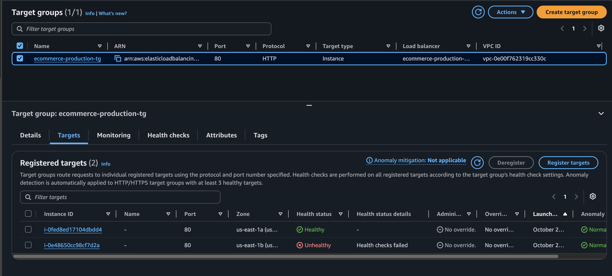
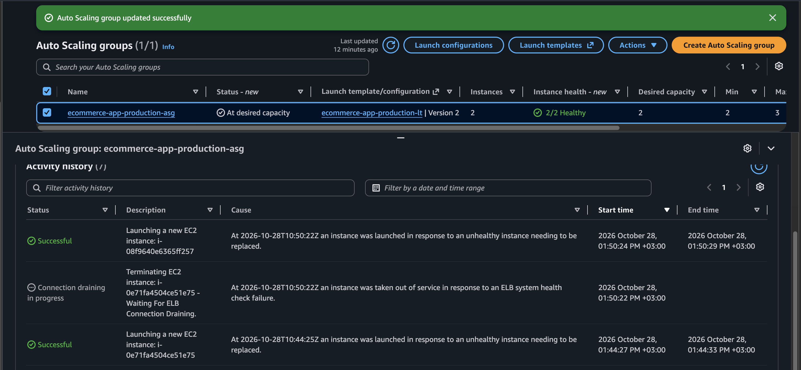
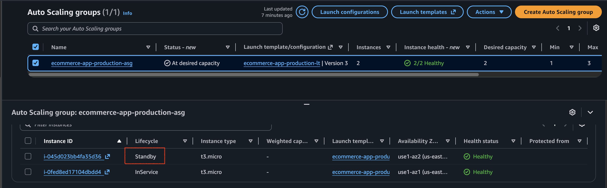
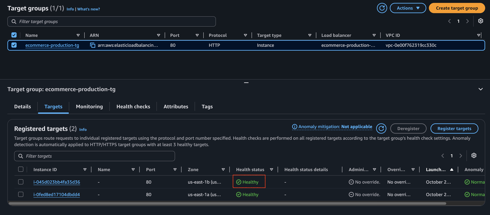
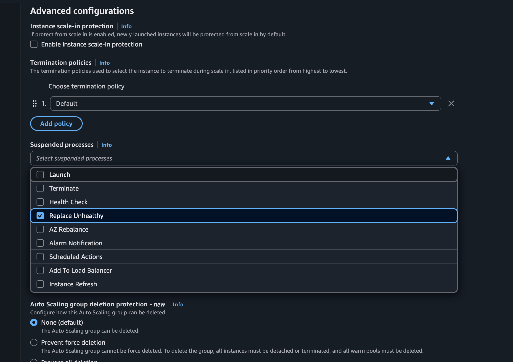
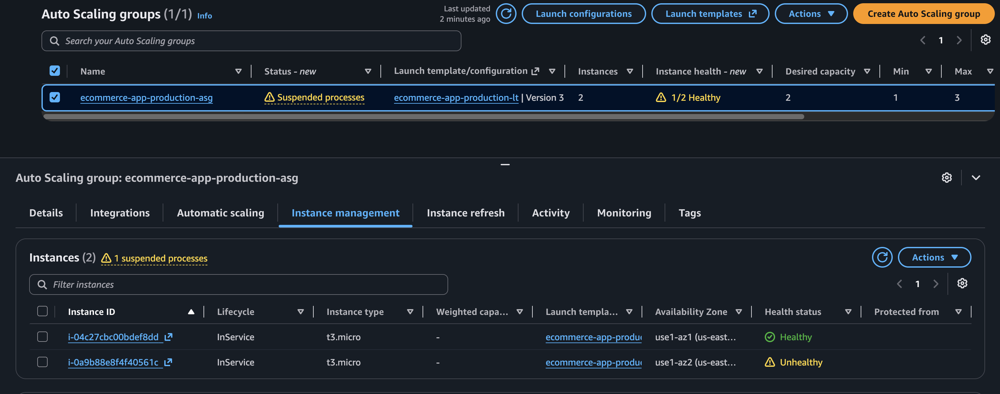
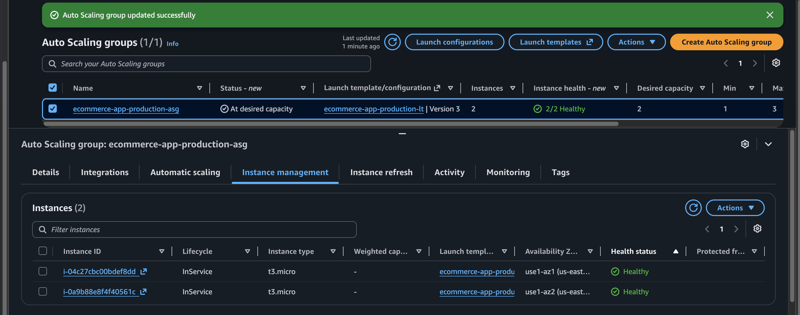

# EC2 Auto Scaling Maintenance

## Overview

This project explores what happens when an EC2 instance managed by an AWS Auto Scaling group needs maintenance.

I tested how Auto Scaling responds when an instance is rebooted, when its web server becomes unhealthy, and when replacement is temporarily suspended during maintenance.

The goal was to understand how to maintain application availability while avoiding unnecessary instance replacement and resource usage.

## AWS Services Used

- Amazon EC2
- EC2 Auto Scaling
- Application Load Balancer (ALB)
- Elastic Load Balancing target groups
- AWS Systems Manager Session Manager
- AWS Identity and Access Management (IAM)

## What I Tested

1. Rebooting an EC2 instance and checking whether Auto Scaling replaced it.
2. Stopping the web server to see how load balancer health checks affected instance replacement.
3. Placing an instance in Standby before maintenance.
4. Suspending unhealthy instance replacement to investigate a simulated application failure.
5. Restoring the application and checking the health status before resuming normal Auto Scaling behaviour.

## Experiment 1: Rebooting an EC2 Instance

I rebooted an EC2 instance through AWS Systems Manager Session Manager to see whether Auto Scaling would replace it simply because it went offline temporarily.

After the reboot, I checked the EC2 status checks and the Auto Scaling group. The instance recovered and remained in service.

**Result:** The reboot did not trigger a replacement in this test.

This showed me that a temporary interruption does not automatically mean an instance needs to be replaced. The health-check configuration and how the Auto Scaling group evaluates instance health matter.

## Experiment 2: Load Balancer Health Checks and Instance Replacement

Next, I stopped Apache on one instance to simulate an application failure.

The EC2 instance was still running, but the Application Load Balancer could no longer get a successful response from the web server. The target became unhealthy, and Auto Scaling replaced the instance because load balancer health checks were enabled for the group.



*The load balancer marked the target unhealthy after the web server stopped responding.*



*Auto Scaling recorded the replacement activity after the instance was marked unhealthy.*

During this test, the first replacement did not start the web server correctly because the launch template's user data script had an issue. I corrected the script and used an updated launch template version so that replacement instances could start the web server successfully.

**Result:** Application-level health checks can lead to instance replacement when the Auto Scaling group is configured to act on those health checks. A working launch template is also important for successful recovery.

## Solution 1: Put the Instance in Standby Before Maintenance

I wanted to try a more controlled approach instead of allowing a maintenance activity to look like an unexpected failure.

I moved one instance into the Auto Scaling group's **Standby** state and chose not to replace it. For this test, I lowered the group's minimum capacity so it could operate with one instance in service while the other was in Standby.



*The instance was placed in Standby for controlled maintenance.*

While the instance was in Standby, I accessed it through Systems Manager Session Manager and checked the web server. I then returned the instance to service and checked the target group.



*Both targets were healthy after the instance returned to service.*

**Result:** Standby provided a controlled way to take an instance out of service while working on it, without requesting an immediate replacement.

The package check found no operating system updates available, so this test demonstrated the maintenance workflow rather than a completed OS patch.

## Solution 2: Suspend Unhealthy Instance Replacement During Maintenance

I also wanted to understand what happens when an instance needs investigation but remains managed by Auto Scaling.

For this test, I suspended the `ReplaceUnhealthy` process and stopped Apache on one instance to simulate an application failure.



*The unhealthy instance replacement process was suspended before the failure test.*

The load balancer marked the target unhealthy, but Auto Scaling did not immediately replace the instance while `ReplaceUnhealthy` was suspended.

After restoring Apache, the target group showed the application as healthy again, but the Auto Scaling group still reported the instance as unhealthy.



*The application target was healthy, but Auto Scaling still reported the instance as unhealthy.*

### Manually Setting the Auto Scaling Health Status

For this controlled experiment, I manually set the instance's health status in the Auto Scaling group to `Healthy` using the AWS CLI.

```bash
aws autoscaling set-instance-health \
  --instance-id YOUR_INSTANCE_ID \
  --health-status Healthy \
  --no-should-respect-grace-period \
  --region us-east-1 \
  --profile asg-maintenance
```

I replaced `YOUR_INSTANCE_ID` with the ID of the instance I was testing. The command completed successfully, and I checked the Auto Scaling group to confirm the recorded health status.

This command changes the health status recorded by Auto Scaling. It does not change the EC2 instance's status checks or the load balancer target's health.

Before performing the manual reset, I had suspended the relevant health-check and replacement processes as part of the controlled test. I resumed the `HealthCheck` process first, while keeping `ReplaceUnhealthy` suspended, and then resumed `ReplaceUnhealthy`.

After that, I checked both the Auto Scaling group and the target group to confirm that both instances were healthy.



*Both instances were healthy after the controlled recovery procedure.*

**Result:** Suspending unhealthy instance replacement can provide time to investigate a problem, but it does not stop health checks or automatically correct an unhealthy status.

Manually setting an instance's status to `Healthy` was useful for this experiment, but it is not a permanent fix for an underlying issue. If health checks detect another failure, the instance may be marked unhealthy again and could be replaced.

## Key Lessons

- A reboot does not automatically trigger an Auto Scaling replacement.
- Load balancer health checks can help Auto Scaling detect application-level failures.
- A working launch template is important for successful instance replacement.
- Standby can provide a controlled way to take an instance out of service for maintenance.
- Suspending `ReplaceUnhealthy` does not stop health checks or automatically fix an unhealthy status.
- The health status recorded by Auto Scaling is separate from EC2 status checks and load balancer target health.
- Resource efficiency matters alongside application availability. Unnecessary replacements can consume additional compute resources and make troubleshooting harder.

## Important Note

This was a controlled lab experiment. No operating system updates were available during the package check, so the project focuses on maintenance procedures, health checks, and instance replacement rather than demonstrating a completed OS patch.

The CLI command and process suspension steps were used for learning in this lab. They should not be applied blindly in production without understanding the impact on instance health management and replacement.

## Region

`us-east-1`

## Author

- [LinkedIn](https://www.linkedin.com/in/catherine-esther-vuthi/)
- [X](https://x.com/Cate_ev)
